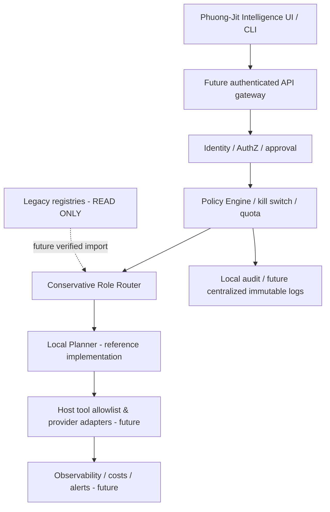

# KIẾN TRÚC MỤC TIÊU — HOÀNG PHƯƠNG CORE v15.2 → v16.0

## Phạm vi và nguyên tắc
Đây là **additive overlay**: dự án độc lập, KHÔNG chỉnh sửa, thay thế, ghi đè hay tự cài bộ plugin gốc v15.1.3. Bộ 7 Skill gốc, 128 role IDs / 16 cụm, 108 mã học tập và danh mục 500 repo thuộc hệ thống cũ; bản prototype không chứa, không giả lập, không thay tên hay hàm của chúng. Tích hợp thực chỉ sau khi tải bản gốc được cho phép, kiểm kê, so hash và chạy regression suite của chính bản gốc. **Không được nói 128 agents đang chạy hoặc 500 repos đã cài.**

## Kiến trúc logic

## Workstream theo phiên bản
| Phiên bản | Thiết kế đích | Đã có trong overlay | Còn thiếu để production |
|---|---|---|---|
| 15.2 Reliability | kill switch, recoverability, policy | fail-closed policy, bounded config, audit integrity | fault injection, rollback thực tế, deployment environment |
| 15.3 Multi-Agent | router, approval, 1–8 roles | heuristic router tối đa 4 role lens | model orchestration thật, 4–8 agent pilot, trace chi phí/token |
| 15.4 Integration | plugin capability gateway | registry yêu cầu tên tool trùng host allowlist | OAuth/MCP, tenant isolation, provider adapters đã xác thực |
| 15.5 Evaluation | golden dataset, benchmark, audit | 13 unit tests + smoke benchmark tổng hợp | ≥200 câu gắn nhãn độc lập, adversarial holdout, CI matrix |
| 16.0 AI Platform | UI/API multi-tenant, jobs, billing/observability | CLI and reference Python modules | authenticated API, queue/jobs, DB migration, user UI, cloud deployment, SLO |

## Ranh giới an toàn
- Mặc định `kill_switch=True`; chỉ `--enable-local-plan` cho phép chạy plan **không tác động hệ thống ngoài**.
- Không có shell execution, network request, email, publication, payment, write/delete lên host.
- `approved=True` KHÔNG là quyền host; hành động nhạy cảm luôn bị từ chối trong prototype.
- Tool registry chỉ kiểm tra metadata, không thực thi tool.
- Audit dùng SQLite/hash chain (có thể dùng HMAC key do host cung cấp); không immutable, không tự bảo đảm dữ liệu riêng tư của toàn máy.
- Không có auth, RBAC thật, encryption at rest, secret manager, sandbox, replay protection, network egress control hoặc quota phân tán.

## Contract tích hợp phần gốc (chưa thực thi)
1. Mount plugin gốc read-only, ghi danh sách path và SHA256 mỗi tệp trước khi thay đổi.
2. Chạy doctor và regressions nguyên bản, xác nhận 7 Skill; 128 contiguous role IDs; 16 cụm; 108 tên + hàm; snapshot 500 entries.
3. Tạo adapter interface: `resolve(capability, current_tool_allowlist) -> status`, không sử dụng quyền chưa có.
4. Chạy overlay như một tiến trình phụ riêng biệt (không chạm registry gốc), theo dõi metrics + log.
5. 4–8 vai trò cho nhiệm vụ thử nghiệm **chỉ sau khi** có môi trường sandbox, hạn mức token/cost, cấp phép host.
6. Nếu mismatch hoặc lỗi: tắt overlay; rollback bằng cách bỏ tiến trình/phân phối mới, plugin gốc nguyên vẹn.

## Phương pháp kiểm chứng
- Unit tests, failure-mode tests, audit tamper detection: chạy tại môi trường Python độc lập.
- Benchmark là cases giả lập và chỉ đo độ trễ LOCAL; KHÔNG suy ra năng lực độc lập của agents, accuracy thực tế hay production SLA.
- Kiểm toán phải tách `[DESIGNED]`, `[PACKAGED]`, `[OFFLINE_TESTED]`, `[HOST_VISIBLE]`, `[EXTERNAL_TOOL_EXECUTED]`, `[DEPLOYED]`, `[BLOCKED]`.
