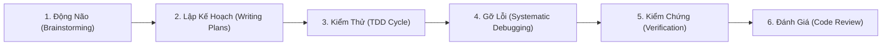

# [/sieunangluc] Bộ Kỹ Năng Siêu Năng Lực Lập Trình & Tác Chiến AI Toàn Diện

> **Quy chuẩn Tinh Lọc Cốt Lõi (Minimum Viable Skill):** Hợp nhất toàn diện các tinh hoa thực chiến từ bộ công cụ `superpowers` (15 kỹ năng rời rạc) thành một tài liệu chuẩn mực duy nhất, loại bỏ hoàn toàn lý thuyết hàn lâm, râu ria thừa thãi và tiết kiệm hơn 80% dung lượng ngữ cảnh (Context Token).

---

## 🎯 NGUYÊN TẮC TỐI THƯỢNG (THE IRON LAWS)

1. **Bằng chứng thực nghiệm trên hết (Evidence Before Claims):** Không có bằng chứng thực thi lệnh = Chưa hoàn thành. Cấm tuyên bố suông.
2. **Không phỏng đoán (Zero Guesswork):** Mọi sửa đổi phải bắt nguồn từ chẩn đoán nguyên nhân gốc rễ (Root Cause), không vá lỗi bề nổi (Symptom Patching).
3. **Kiểm thử dẫn đường (Test-Driven):** Không viết code sản phẩm nếu chưa có bài kiểm thử thất bại (Failing Test) được xác nhận trước đó.
4. **Phản biện kỹ thuật thay vì xã giao:** Tiếp nhận review và thảo luận dựa trên tính đúng đắn kỹ thuật, cấu trúc dữ liệu và logic thực tế thay vì đồng thuận xã giao.

---

## 🏛️ 6 TRỤ CỘT THỰC CHIẾN VÀNG

### TRỤ CỘT 1: ĐỘNG NÃO & THIẾT KẾ GIẢI PHÁP (BRAINSTORMING)
*Kích hoạt trước khi bắt tay viết bất kỳ tính năng, refactor hay cấu trúc logic mới.*

1. **Thấu hiểu bản chất yêu cầu:**
   - Đặt câu hỏi làm rõ: *Người dùng thực sự cần gì? Tại sao họ cần tính năng này? Ràng buộc cốt lõi là gì?*
   - Phát hiện các yêu cầu tiềm ẩn, edge-cases hoặc rủi ro xung đột kiến trúc trước khi viết dòng code đầu tiên.
2. **Đề xuất 2 - 3 phương án kiến trúc (Lay Out Approaches):**
   - Phác thảo rõ ràng từng hướng giải quyết: Ưu điểm, nhược điểm, chi phí triển khai, độ phức tạp bảo trì.
   - Luôn khuyến nghị phương án tối giản nhất (Minimal Viable Architecture / YAGNI).
3. **Thống nhất Tài liệu Thiết kế Tinh gọn (Design Spec):**
   - Định rõ API Contracts, mô hình dữ liệu, thay đổi schema, luồng xử lý lỗi và thư viện sử dụng.
   - Chốt giải pháp với người dùng trước khi tiến hành bước tiếp theo.

---

### TRỤ CỘT 2: LẬP KẾ HOẠCH 2 TẦNG & CHIA NHỎ TÁC VỤ (WRITING & EXECUTING PLANS)
*Kích hoạt khi bài toán gồm nhiều bước hoặc đụng chạm nhiều module.*

1. **Bản đồ cấu trúc file (File Structure Mapping):**
   - Liệt kê chính xác danh sách file sẽ tạo mới hoặc sửa đổi.
   - Nguyên tắc đơn trách nhiệm (Single Responsibility): Mỗi file đảm nhận một vai trò rõ ràng. File sửa cùng nhau nên đặt gần nhau.
2. **Chia nhỏ tác vụ hạt nhân (Task Right-Sizing):**
   - Mỗi tác vụ là đơn vị công việc độc lập nhỏ nhất, có thể nghiệm thu và có bài kiểm thử riêng biệt.
   - Định dạng chuẩn cho mỗi tác vụ:
     * **Mục tiêu:** Mô tả ngắn gọn kết quả cần đạt.
     * **Vị trí sửa:** Đường dẫn file cụ thể + Neo Hồng Tâm (Semantic Anchor - tên hàm, DOM ID, class).
     * **Bài kiểm thử:** Test case cụ thể chứng minh tác vụ hoàn thành.
     * **Lệnh nghiệm thu:** Lệnh shell kiểm tra kết quả ngay lập tức.
3. **Thực thi liên tục & Ra phán quyết (Inline Execution & Rulings):**
   - Thực thi dứt khoát từng tác vụ, không ngập ngừng hỏi những điều vụn vặt.
   - Khi gặp mơ hồ hoặc xung đột: Ra phán quyết kỹ thuật dựa trên Spec theo cấu trúc: `Phán quyết: <Đã chọn gì> — <Lý do> — <Rủi ro nếu sai>`.

---

### TRỤ CỘT 3: LẬP TRÌNH HƯỚNG KIỂM THỬ (TEST-DRIVEN DEVELOPMENT - TDD)
*Kích hoạt cho mọi tính năng mới, sửa lỗi (bugfix) hoặc refactor mã nguồn.*

> [!CRITICAL]
> **THIẾT LUẬT SẮT VỀ TDD:**
> TUYỆT ĐỐI CẤM VIẾT CODE SẢN PHẨM KHI CHƯA CÓ BÀI KIỂM THỬ BỊ FAIL (RED TEST). Nếu viết code trước test: Xóa đi và làm lại đúng quy trình!

1. **Pha Đỏ (Red - Viết Test Thất Bại):**
   - Viết bài unit/integration test phản ánh đúng yêu cầu mới hoặc kịch bản gây ra lỗi.
   - Chạy test và **TẬN MẮT XÁC NHẬN TEST THẤT BẠI** với đúng lỗi mong đợi. Nếu test pass ngay: Test vô nghĩa hoặc viết sai logic.
2. **Pha Xanh (Green - Viết Code Vừa Đủ Để Pass):**
   - Viết lượng mã nguồn tối thiểu để bài test vượt qua (Minimal Viable Code).
   - Không tiện tay viết thêm tính năng ngoài phạm vi bài test.
3. **Pha Tinh Chỉnh (Refactor):**
   - Dọn dẹp mã nguồn, tối ưu hóa thuật toán, chuẩn hóa tên biến, khử trùng lặp (DRY).
   - Đảm bảo toàn bộ test suite vẫn xanh 100% sau khi refactor.

---

### TRỤ CỘT 4: GỠ LỖI CÓ HỆ THỐNG (SYSTEMATIC DEBUGGING)
*Kích hoạt khi gặp lỗi biên dịch, test fail, runtime exception hoặc hành vi bất thường.*

> [!WARNING]
> **THIẾT LUẬT SẮT VỀ GỠ LỖI:**
> CẤM SỬA CHỮA HOẶC ĐOÁN MÒ KHI CHƯA CHẨN ĐOÁN XÁC ĐỊNH NGUYÊN NHÂN GỐC RỄ (ROOT CAUSE).
> Sửa triệu chứng bề nổi (Symptom Patching) là thất bại hoàn toàn.

1. **Tái hiện lỗi tin cậy (Reproduce):**
   - Tạo bài test tối thiểu hoặc kịch bản lệnh tái hiện lỗi 100% số lần chạy.
2. **Cô lập vùng hỏng hóc (Isolate):**
   - Đọc kỹ stack trace, xác định chính xác dòng code kích hoạt lỗi.
   - Xác định ranh giới giữa dữ liệu hợp lệ và dữ liệu bất thường bằng log thực nghiệm.
3. **Truy tìm nguyên nhân gốc rễ (Root Cause Analysis - 5 Whys):**
   - Không dừng lại ở triệu chứng: *Tại sao biến bị undefined? Tại sao promise bị reject? Tại sao race-condition xảy ra?*
   - Xây dựng giả thuyết kỹ thuật và kiểm chứng giả thuyết bằng dữ liệu thực tế.
4. **Khắc phục triệt để & Kiểm thử ngăn hồi quy (Regression Guard):**
   - Áp dụng sửa chữa trực tiếp tại nguyên nhân gốc rễ.
   - Chạy lại bài test tái hiện lỗi (đã pass) và toàn bộ test suite của dự án.

---

### TRỤ CỘT 5: KIỂM CHỨNG THỰC TẾ TRƯỚC KHI HOÀN THÀNH (VERIFICATION BEFORE COMPLETION)
*Kích hoạt trước khi tuyên bố hoàn thành, nộp báo cáo hoặc gửi code review.*

> [!IMPORTANT]
> **CỔNG KIỂM SOÁT THỰC NGHIỆM (GATE FUNCTION):**
> Trước khi kết luận hoặc báo cáo bất kỳ trạng thái thành công nào:
> 1. **Xác định lệnh kiểm chứng:** Lệnh nào chứng minh mã nguồn chạy đúng? (Test runner, Build command, CLI invocation, HTTP curl...).
> 2. **Chạy lệnh trực tiếp:** Chạy lệnh tươi mới (Fresh Run) trong phiên làm việc.
> 3. **Đọc toàn bộ kết quả:** Xác nhận Exit Code = 0, số lượng tests passed, không có cảnh báo ẩn (hidden warnings).
> 4. **Trích xuất bằng chứng:** Đưa log thực tế và Code Diff vào báo cáo.

---

### TRỤ CỘT 6: ĐÁNH GIÁ & TIẾP NHẬN CODE REVIEW NGHIÊM CẨN (CODE REVIEW DISCIPLINE)
*Áp dụng khi gửi yêu cầu rà soát code hoặc khi tiếp nhận phản hồi từ đồng đội/người dùng.*

1. **Quy tắc Tiếp Nhận Phản Hồi (Receiving Review):**
   - **Cấm khen ngợi sáo rỗng:** Tuyệt đối không nói *"Bạn hoàn toàn đúng!"*, *"Ý kiến xuất sắc!"*.
   - **Đọc & Tái hiện:** Đọc kỹ toàn bộ feedback, tóm tắt lại yêu cầu kỹ thuật bằng ngôn từ chính xác.
   - **Xác minh thực tế trên Codebase:** Kiểm tra xem góp ý có phù hợp với kiến trúc và luồng dữ liệu hiện tại hay không trước khi sửa.
   - **Sửa từng điểm một:** Giải quyết từng hạng mục, có test chứng minh và nghiệm thu độc lập.
2. **Quy tắc Rà Soát Mã Nguồn (Reviewing Code):**
   - Rà soát các vấn đề trọng yếu: Logic ranh giới (Edge cases), Rò rỉ tài nguyên / bộ nhớ, Lỗ hổng bảo mật (Injection, Trust Boundaries), Hiệu năng thuật toán (Big-O).
   - Đưa ra đề xuất sửa đổi cụ thể kèm đoạn code mẫu thay thế rõ ràng.

---

## ⚡ HƯỚNG DẪN KÍCH HOẠT VÀ SỬ DỤNG

- **Kích hoạt toàn bộ quy chuẩn:** Gõ `/sieunangluc <tác vụ>`
- **Kích hoạt phân hệ chuyên biệt:**
  * Khi bắt đầu tính năng mới: Yêu cầu Brainstorming & Writing Plans.
  * Khi xuất hiện bug/lỗi: Yêu cầu Systematic Debugging & Root Cause Analysis.
  * Trước khi chốt phiên: Yêu cầu Verification Before Completion với bằng chứng thật.
